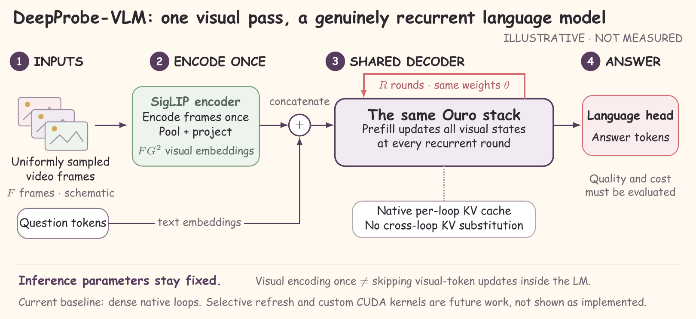

# DeepProbe-VLM

原生共享权重循环模型的视频 SFT 研究。实验与论文分别同步，代码不混入论文目录，训练数据与权重不进入 Git。

```text
DeepProbe-VLM/
├── experiment/                 # 实验：安装、数据、训练、评测与分析
│   ├── README.md               # 可执行的上机步骤
│   ├── docs/REQUIREMENTS.md     # 实验要求、运行顺序、验收与交付清单
│   ├── configs/                # 固定模型/数据版本与训练配置
│   ├── src/                    # 原生循环 VLM 实现
│   ├── scripts/                # 数据、启动、自检与统计工具
│   ├── tests/                  # CPU 契约测试
│   ├── requirements/
│   └── docker/
└── paper/                      # 论文：源文件、PDF、图与绘图源代码
    ├── README.md               # 文稿状态与编译说明
    ├── experiment_protocol.tex
    ├── experiment_protocol.pdf
    ├── figures/source/         # 可编辑 XeLaTeX/TikZ 图
    ├── figures/final/          # PDF / PNG / SVG 成图
    ├── figures/candidates/     # 六份布局候选与总览
    └── docs/FIGURE_AUDIT.md
```

## 从哪里开始

- **跑实验**：先读 [实验要求清单](experiment/docs/REQUIREMENTS.md)，再按 [上机指南](experiment/README.md) 执行。全部实验命令以 `experiment/` 为工作目录。
- **看论文和图**：进入 [paper/](paper/README.md)。当前同步的是五页实验协议及三张方法/流程图，不是已有结果的完整论文。
- **核对可信边界**：[已验证事项](experiment/docs/VALIDATION.md)、[模型契约](experiment/docs/MODEL_CONTRACT.md)、[实验矩阵](experiment/docs/EXPERIMENTS.md)。
- **看真实结果与进度**：[已验收结果](experiment/results/RESULTS.md)、[当前实验状态](experiment/results/STATUS.md)。
- **下载可复核的结果**：[2026-11-19 完整结果包](experiment/results/releases/2026-11-19/README.md)、[ModelScope 数据集](https://modelscope.ai/datasets/JasonJin/DeepProbe-VLM)。包含 8,554 条逐题记录、配对统计和 400 条 CUDA 算子计时；SHA 清单区分原始证据与脱敏副本。

```bash
git clone https://github.com/Sunbeam23333/DeepProbe-VLM.git
cd DeepProbe-VLM/experiment
# 先准备兼容服务器 GPU 的 PyTorch，再安装这些依赖。
python -m pip install -r requirements/train.txt
python -m pip install --no-deps -e .
python -m pytest -q
```

从旧目录布局升级后，需要从 `experiment/` 重新执行 editable 安装。已有数据、缓存和运行目录不会自动迁移；保留原目录，使用明确路径，或自行安排存储迁移。不要因拉取代码而覆盖已有检查点。

## 当前状态

已实现：Ouro 原生循环、连接器对齐、全主干 SFT、普通模型对照、数据准备、参考评测与断点续训。

截至 **2026-11-21**，已验收的模型评测仍为 R1/R2 seed17：两者已完成两阶段训练，Video-MME 的声明 899 视频子集准确率为 **6.3404% / 18.4650%**，TempCompass 多选准确率为 **42.5316% / 50.4430%**。Video-MME 包含较高无效回答率，不代表官方全量成绩；协议、配对统计、局限与证据摘要见[结果记录](experiment/results/RESULTS.md)。

Smol a6 已从 checkpoint350 完成剩余 **368 步**，对齐训练达到 **718/718 步**，训练子进程和两次预检均 exit0。原 Job 随后在归档阶段 Failed/exit1，该原始状态保持不变。归档恢复已于 11 月 21 日 **03:19 北京时间**验收：补传 158 件后，完整 **240 件 / 18.150 GB** 归档通过逐件完整 GET/SHA 和独立审计；完成的 final 也已成功导入实验套件历史，不再重复对齐训练。尚无 Smol SFT 完成或新增模型评测成绩。R4 checkpoint600 已通过归档完整 GET/SHA 和原生元数据检查，其剩余 **118 步** SFT、运行时状态恢复与评测仍待执行（新套件 CPU 与调度准入已通过）。具体证据和剩余任务见[当前状态](experiment/results/STATUS.md)。

历史上 a5 在 **11 月 18 日 02:37:32 北京时间**于日志 354/718 步中断；该事实及 11 月 19 日全部课题作业终止的快照保留在状态记录中，后续 a6 已完成对齐训练。a3、a4 的失败归档分别验收，a5 的实际 GPU 握手和八 rank BF16/NCCL 预检也通过；这些工程验收不代表恢复数值等价性或新模型质量已验收。

CUDA QA a3 已通过八卡启动自检、真实 BF16/FP32 池化数值与单算子计时检查，并完成独立归档验收。这些结果覆盖单卡合成输入的池化算子；完整模型、分布式训练及 H20/B300 对比的速度结论仍待测量。[完整实验矩阵](experiment/docs/EXPERIMENT_SUITE.md)保留全部 **185 个计划任务**，剩余 **27 个新训练阶段、R4 的 118 步续训和 32 项新模型评测**，以及成本、延迟和统计比较。最新公开代码已同步至 `65e562c`，本次查询修复的 **137 项相关 CPU 测试**通过，此前 190 项记录保留。v6 完整候选于 **04:25:13 北京时间**通过 CPU 准入（68 项通过、4 项缓存延期、0 失败），**04:28:09** server dry-run、**04:30:30** 独立准入分别通过。最坏检查点链 **142.546 GB**，低于 150 GB，后续每项任务仍会重测容量。

新 attempt-2 已实际提交并通过八卡硬件和启动验收，包括 CC10.3/267.69 GiB、attention 前后向和 all-reduce。但首次工程 `gpu_gate` 在 Triton 初始化时无法写入默认 `/.triton` 缓存目录，**04:36:26 北京时间回读为 Failed、exit1、重启 0 次**。目标数值 kernel 尚未执行，不能据此认定 CUDA 数值错误。**没有训练/评测任务启动或新 optimizer 更新**；正在准备显式课题缓存目录修复及下一次独立准入。该作业配置为一个 normal 优先级、stream 单节点八卡 worker。第一轮 worker 的控制器超时失败已独立保留，18 件小型失败归档通过完整 GET/SHA，原训练结果不受改写。

Video-MME 与 TempCompass 的 **F8 缓存均为 READY**；F4/F16 CPU 解码与发布已受控重启，四项新 READY 尚待完成。训练按自身输入与容量准入，评测各自等待 READY。17 个检查点依赖组件串行推进，只有完成归档校验及所有评测、延迟等消费者后才删除本地 checkpoint。[当前状态](experiment/results/STATUS.md)和[新进度快照](experiment/results/releases/2026-11-21-progress-v4/README.md)保留准确观察时刻与证据摘要。

11 月 21 日 **01:13 北京时间**的清理验收确认：6 个已归档旧检查点重量文件释放 **17.117 GB**，受控 `/home` 目录实测 **62.504 GB**，a6 文件全部保留，原 a6 的 42 GB 预留已释放；其他活动预留仍保留，GPU 准入前必须重测。11 月 19 日 `/home` 60.51 GB、OSS 1.023 TB 及旧 P0 删除返回 `403 AccessDenied`、回收 0 B 均是历史快照。当前取消 OSS 容量上限，保留 `/home` 150 GB 共享预算；本地 checkpoint 仅在完整归档校验和全部消费者完成后清理。代码与 CPU 测试通过不等于 GPU 准入或实验完成。

训练恢复现在预检 optimizer/scheduler/RNG 等必需状态；推理新增显式启用的最后位置 logits 投影、Triton 融合空间池化和独立 profiler 诊断。默认训练及参考评测保持原路径。实现范围、已验收的 CUDA 证据与待补的模型测量见[优化记录](experiment/docs/OPTIMIZATION_STATUS.md)。选择性视觉刷新、token compaction、跨轮 KV 共享和 TTT 尚未实现；新增池化核不等于这些研究机制已经完成。

Git 同步代码、测试和经过核对的结果包，包括移除私有模型路径的逐题预测。数据集视频、模型权重、私人邮件、学生身份信息及原始集群快照不在仓库中。



论文源码和图的源文件/成图均跟随 Git 同步；运行产物默认忽略。真实实验完成后，再将经过审查的汇总结果与图加入 `paper/`，不要把原始训练目录整体提交。
