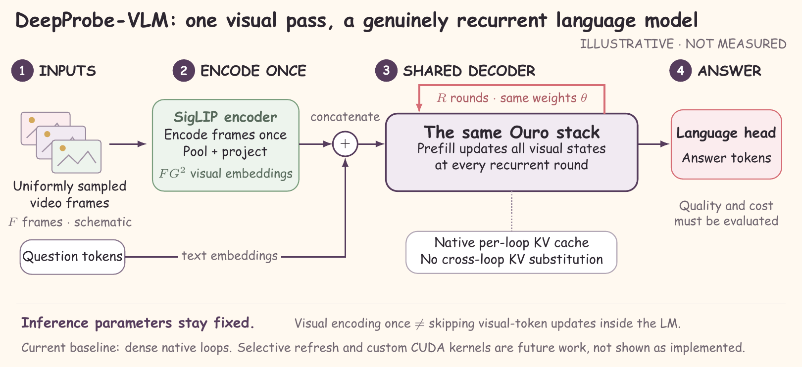

# DeepProbe-VLM

原生共享权重循环模型的视频 SFT 研究。实验与论文分别同步，代码不混入论文目录，训练数据与权重不进入 Git。

```text
DeepProbe-VLM/
├── experiment/                 # 实验：安装、数据、训练、评测与分析
│   ├── README.md               # 可执行的上机步骤
│   ├── docs/REQUIREMENTS.md     # 实验要求、运行顺序、验收与交付清单
│   ├── configs/                # 固定模型/数据版本与训练配置
│   ├── src/                    # 原生循环 VLM 实现
│   ├── scripts/                # 数据、启动、自检与统计工具
│   ├── tests/                  # CPU 契约测试
│   ├── requirements/
│   └── docker/
└── paper/                      # 论文：源文件、PDF、图与绘图源代码
    ├── README.md               # 文稿状态与编译说明
    ├── experiment_protocol.tex
    ├── experiment_protocol.pdf
    ├── figures/source/         # 可编辑 XeLaTeX/TikZ 图
    ├── figures/final/          # PDF / PNG / SVG 成图
    ├── figures/candidates/     # 六份布局候选与总览
    └── docs/FIGURE_AUDIT.md
```

## 从哪里开始

- **跑实验**：先读 [实验要求清单](experiment/docs/REQUIREMENTS.md)，再按 [上机指南](experiment/README.md) 执行。全部实验命令以 `experiment/` 为工作目录。
- **看论文和图**：进入 [paper/](paper/README.md)。当前同步的是五页实验协议及三张方法/流程图，不是已有结果的完整论文。
- **核对可信边界**：[已验证事项](experiment/docs/VALIDATION.md)、[模型契约](experiment/docs/MODEL_CONTRACT.md)、[实验矩阵](experiment/docs/EXPERIMENTS.md)。
- **看真实结果与进度**：[已验收结果](experiment/results/RESULTS.md)、[当前实验状态](experiment/results/STATUS.md)。

```bash
git clone https://github.com/Sunbeam23333/DeepProbe-VLM.git
cd DeepProbe-VLM/experiment
# 先准备兼容服务器 GPU 的 PyTorch，再安装这些依赖。
python -m pip install -r requirements/train.txt
python -m pip install --no-deps -e .
python -m pytest -q
```

从旧目录布局升级后，需要从 `experiment/` 重新执行 editable 安装。已有数据、缓存和运行目录不会自动迁移；保留原目录，使用明确路径，或自行安排存储迁移。不要因拉取代码而覆盖已有检查点。

## 当前状态

已实现：Ouro 原生循环、连接器对齐、全主干 SFT、普通模型对照、数据准备、参考评测与断点续训。

截至 **2026-11-09**，R1/R2 seed17 已完成两阶段训练和评测：Video-MME 的声明 899 视频子集准确率为 **6.3404% / 18.4650%**，TempCompass 多选准确率为 **42.5316% / 50.4430%**。Video-MME 包含较高无效回答率，不代表官方全量成绩；协议、配对统计、局限与证据摘要见[结果记录](experiment/results/RESULTS.md)。

R4 alignment 已完成；R4 SFT 在 602/718 步后收到 SIGTERM，保存了 600 步检查点，尚无 R4 评测成绩。Smol 基线、额外训练种子、剩余消融及正式成本/延迟实验仍待完成，详见[当前状态](experiment/results/STATUS.md)。尚无 H20/B300 加速结论。选择性视觉刷新、跨轮 KV 共享、TTT 和自定义 CUDA/PTX 属于待验证分支。

Git 只同步代码、测试和经过核对的结果摘要。数据集视频、模型权重、私人邮件、学生身份信息及原始集群快照不在仓库中。



论文源码和图的源文件/成图均跟随 Git 同步；运行产物默认忽略。真实实验完成后，再将经过审查的汇总结果与图加入 `paper/`，不要把原始训练目录整体提交。
